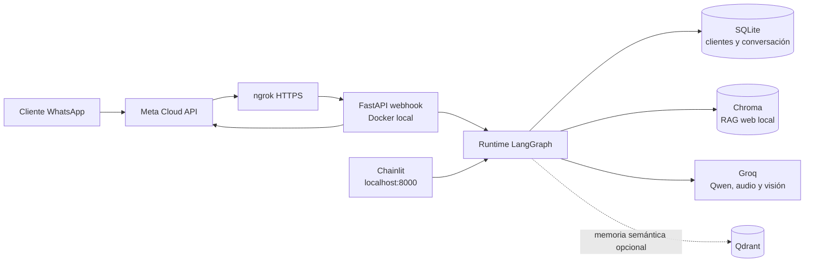

# Collections agent: prototipo local de WhatsApp

Prototipo local de un agente de cobranza por WhatsApp con LangGraph, SQLite y Groq. La rama `main`
es la versión funcional para ejecutar en el equipo: Docker Compose levanta Chainlit, el webhook de
Meta y ngrok. La rama `aws-deployment` conserva la variante de arquitectura AWS para presentación;
no significa que haya recursos desplegados en una cuenta AWS.

Ambas variantes comparten el flujo LangGraph y mantienen las operaciones financieras bajo control
determinista. `main` usa SQLite como fuente de saldos y promesas ficticias; el modelo no puede
inventar montos ni registrar una promesa sin confirmación. El escenario CLI aislado funciona sin
Groq, AWS ni credenciales de Telegram.

| Variante | Rama | Para qué sirve |
|---|---|---|
| Local | [`main`](https://github.com/marestrepohi/lla-wapp-agent/tree/main) | Docker Compose, Chainlit, webhook Meta por ngrok, SQLite, Chroma y Groq. |
| Arquitectura AWS | [`aws-deployment`](https://github.com/marestrepohi/lla-wapp-agent/tree/aws-deployment) | Variante documentada para mostrar cómo migraría el prototipo; el demo que se ejecuta es local. |

La guía local está en [`langchain-agent/README.md`](langchain-agent/README.md). La arquitectura
visual de la ejecución local está en [docs/architecture-local.html](docs/architecture-local.html);
la propuesta de arquitectura AWS y la trazabilidad de la evaluación están en `docs/architecture.md`
y `docs/assessment-compliance.md`.

## Estado de la implementación local (`main`)

La versión local incluye WhatsApp Cloud API detrás de ngrok y un entorno Docker Compose. El
[diagrama de arquitectura local](docs/architecture-local.html) muestra los servicios y recorridos.
La guía explica cómo levantar la interfaz, configurar Meta y usar los datos de QA sin desplegar
infraestructura en AWS.



El [diagrama visual completo](docs/architecture-local.html) incluye límites, conexiones y roles de
cada componente. Este flujo local es el que se ejecuta para la demo.

En el seguimiento de pagos, LangGraph conserva monto, fecha y etapa entre mensajes. Respuestas como
`100 para la otra semana` y `El viernes` se resuelven con reglas locales y SQLite, sin pasar por RAG
ni por la extracción de memoria. La promesa queda como propuesta pendiente y solo se registra tras
la confirmación explícita que identifica monto y fecha. El webhook registra tiempos de proceso sin
incluir el teléfono ni el contenido del cliente.

## Inicio rápido

```bash
uv sync --project langchain-agent
uv run --project langchain-agent python demo/run_demo.py
```

El escenario de demostración funciona sin Groq ni credenciales de AWS. Para instalar las
herramientas opcionales de desarrollo:

```bash
uv sync --project langchain-agent --extra dev
uv run --project langchain-agent pytest
uv run --project langchain-agent ruff check .
```

El demo recorre ejemplos de negociación, promesa confirmada, saldo en disputa, descuento no
autorizado, escalamiento humano, cliente desconocido, fallo de herramienta y solicitud de no contacto.

## Estructura del proyecto

```text
src/lla_agent/
  domain/       Entidades y respuestas independientes del canal
  persistence/  Repositorio SQLite y datos locales de ejemplo
  tools/        Consultar saldo, registrar promesa y escalar a una persona
  application/  Operaciones deterministas que invoca LangGraph
  channels/     Adaptadores de transporte para Telegram y WhatsApp
demo/           Demo de conversación ejecutable sin servicios externos
tests/          Pruebas de herramientas y decisiones
docs/           Diagramas local y AWS, diseño y trazabilidad de la prueba
langchain-agent/ Runtime LangGraph con Groq, RAG web local e interfaz Chainlit
```

## Adaptador de demostración para Telegram

Para ejecutar el adaptador de Telegram con polling, instala su dependencia opcional y configura
el token fuera del control de versiones:

```bash
uv sync --project langchain-agent --extra telegram
export TELEGRAM_BOT_TOKEN="..."
uv run --project langchain-agent python -m lla_langchain_agent.telegram
```

El proceso de Telegram abre un runtime compartido. No infiere `client_id` del texto: configura una
asociación confiable entre el ID externo de Telegram y un cliente de prueba antes de consultar una
cuenta. El adaptador de WhatsApp en `src/lla_agent/channels/whatsapp.py` también requiere un evento
verificado y recibe la identidad de su llamador. El repositorio no incluye tokens de WhatsApp.

## Runtime local de LangChain y RAG

La guía de [`langchain-agent/README.md`](langchain-agent/README.md) explica cómo ejecutar LangGraph
y abrir Chainlit. El proceso compila un grafo y mantiene abierto un checkpointer SQLite; cada canal
envía un evento normalizado. La interfaz muestra extracción web, fragmentación, embeddings locales,
índice Chroma compartido, recuperación, fuentes y resultados de herramientas. Las acciones
financieras usan datos SQLite ficticios; una promesa se registra solo después de confirmarla.

## Ejecución local con Docker

Docker Compose inicia Chainlit en `http://localhost:8000`. Para levantar también el webhook de
WhatsApp y el túnel ngrok, configura las claves y variables de WhatsApp en `langchain-agent/.env`.
Si el archivo aún no existe, créalo desde el ejemplo y completa sus valores:

```bash
cp langchain-agent/.env.example langchain-agent/.env
```

Después ejecuta:

```bash
docker compose up --build
docker compose --profile whatsapp up --build
docker compose --profile whatsapp logs -f ngrok
```

El segundo comando inicia el webhook en el puerto local `8001`; ngrok se conecta por la red privada
de Compose. Copia la URL HTTPS de ngrok en Meta como `https://<dominio-ngrok>/webhook` y utiliza el
mismo `WHATSAPP_VERIFY_TOKEN` de `langchain-agent/.env`. El túnel reutiliza la configuración ngrok
de `${HOME}/.config/ngrok/ngrok.yml`; define `NGROK_CONFIG_PATH` si la guardaste en otra ruta. Los
servicios de Compose leen las claves del archivo local, pero no las copian a la imagen. El agente
usa Groq con el modelo de `GROQ_MODEL` (por defecto `qwen/qwen3.8-27b`); esa clave también habilita
el procesamiento de audio e imágenes.

El volumen Docker `agent-data` conserva entre reinicios la base SQLite de prueba, los checkpoints
de LangGraph, el índice Chroma y el modelo de embeddings descargado. `docker compose down` mantiene
esos datos; `docker compose down --volumes` los elimina. La primera consulta RAG o de memoria Qdrant
descarga el modelo ONNX de embeddings en ese volumen. El webhook aún no valida la firma de los POST
entrantes de WhatsApp; usa este túnel solo para QA local con datos ficticios.

Para iniciar una conversación con un template aprobado, envíalo desde el contenedor local. No se
expone una ruta administrativa sin autenticación en el túnel público. Sustituye el destinatario por
un número internacional autorizado para la prueba y confirma el envío explícitamente:

```bash
docker compose --profile whatsapp exec whatsapp-webhook \
  python /app/scripts/send_whatsapp_template.py \
  --to "+57<NUMERO_DESTINO>" \
  --template-name <TEMPLATE_APROBADO_QUE_PREGUNTA_POR_SANTIAGO> \
  --language es \
  --body-parameter "Santiago" \
  --opening-context '{"v":"1","flow":"contact_confirmation","contact_name":"Santiago","opening_message":"Hola Santiago, te escribimos de LLA para dar seguimiento a tu servicio. ¿Hablo contigo?"}' \
  --confirm-send
```

Meta debe tener el template aprobado y habilitado. Un cuerpo posible es `Hola {{1}}, te escribimos
de LLA para dar seguimiento a tu servicio. ¿Hablo contigo?`, con `Santiago` como parámetro 1. El
texto renderizado debe coincidir con `--opening-context`; el callback solo transporta contexto y no
modifica el template. El comando lee el token y el ID de teléfono de `langchain-agent/.env`, imprime
el `wamid` de Meta y guarda el contexto inicial. Un `curl` directo puede enviar el mismo campo
`biz_opaque_callback_data`; el webhook también lo guarda al recibir los estados de Meta.

Para enviar directamente desde WSL, carga primero el archivo local ignorado por Git y reemplaza el
nombre del template y el destinatario por valores habilitados en tu cuenta de WhatsApp:

```bash
set -a
source langchain-agent/.env
set +a
curl -i -X POST \
  "https://graph.facebook.com/${WHATSAPP_GRAPH_API_VERSION:-v25.0}/${WHATSAPP_PHONE_NUMBER_ID}/messages" \
  -H "Authorization: Bearer ${WHATSAPP_TOKEN}" \
  -H "Content-Type: application/json" \
  -d '{
    "messaging_product": "whatsapp",
    "to": "57<NUMERO_DESTINO>",
    "type": "template",
    "biz_opaque_callback_data": "{\"v\":\"1\",\"flow\":\"contact_confirmation\",\"contact_name\":\"Santiago\",\"opening_message\":\"Hola Santiago, te escribimos de LLA para dar seguimiento a tu servicio. ¿Hablo contigo?\"}",
    "template": {
      "name": "<TEMPLATE_APROBADO_QUE_PREGUNTA_POR_SANTIAGO>",
      "language": { "code": "es" },
      "components": [{
        "type": "body",
        "parameters": [{ "type": "text", "text": "Santiago" }]
      }]
    }
  }'
```

En PowerShell, `curl.exe` puede leer las tres variables del mismo `.env` sin imprimir el token:

```powershell
$settings = @{}
Get-Content .\langchain-agent\.env | ForEach-Object {
  if ($_ -match '^(WHATSAPP_TOKEN|WHATSAPP_PHONE_NUMBER_ID|WHATSAPP_GRAPH_API_VERSION)=(.*)$') {
    $settings[$Matches[1]] = $Matches[2].Trim().Trim('"').Trim("'")
  }
}
$version = if ($settings['WHATSAPP_GRAPH_API_VERSION']) { $settings['WHATSAPP_GRAPH_API_VERSION'] } else { 'v25.0' }
$opening = '{"v":"1","flow":"contact_confirmation","contact_name":"Santiago","opening_message":"Hola Santiago, te escribimos de LLA para dar seguimiento a tu servicio. ¿Hablo contigo?"}'
$payload = @{
  messaging_product = 'whatsapp'
  to = '57<NUMERO_DESTINO>'
  type = 'template'
  biz_opaque_callback_data = $opening
  template = @{
    name = '<TEMPLATE_APROBADO_QUE_PREGUNTA_POR_SANTIAGO>'
    language = @{ code = 'es' }
    components = @(@{ type = 'body'; parameters = @(@{ type = 'text'; text = 'Santiago' }) })
  }
} | ConvertTo-Json -Depth 8 -Compress
curl.exe -i -X POST "https://graph.facebook.com/$version/$($settings['WHATSAPP_PHONE_NUMBER_ID'])/messages" `
  -H "Authorization: Bearer $($settings['WHATSAPP_TOKEN'])" `
  -H 'Content-Type: application/json' `
  --data-raw $payload
```

Cuando la persona responde, el grafo local confirma el nombre, pide el ID del cliente, vincula ese
número al registro de QA y presenta el saldo y el detalle de facturas de SQLite. Si el perfil se
genera para la prueba, el agente lo aclara una vez y no repite el aviso en los turnos siguientes.

## Ejemplos de conversación

El agente requiere una identidad de cliente asociada antes de revelar un saldo. En el demo, se
representa con `client_id="C001"`:

- “Quiero pagar en dos semanas” → reads the current billing balance and offers a promise.
- `confirmo propuesta 1250.00 2026-11-15` → registra la propuesta pendiente solo si coincide exactamente el monto y la fecha.
- “No reconozco este saldo” → consulta la cuenta y escala la disputa.
- “Aplícame un descuento no autorizado” → no inventa ni aplica descuentos; escala el caso.
- “Hablar con un asesor” → escala con un resumen.
- “STOP” / “no me contacten” → registra la solicitud y detiene mensajes de cobranza.

Las operaciones deterministas son el límite auditable del negocio que invoca LangGraph. El subgrafo
`create_agent` de Groq resuelve preguntas generales con búsqueda acotada del cliente, RAG sobre
páginas públicas y memoria no financiera por cliente. Las acciones de cobranza usan rutas explícitas
del grafo y herramientas SQLite protegidas. Los checkpoints usan un `thread_id` estable, calculado
con hash y delimitado por canal, conversación y cliente seleccionado.

## Configuración y límites

- `LLA_DB_PATH` controls the SQLite file (default: `./data/collections.sqlite3`).
- No se incluyen secretos en el código. El adaptador de Telegram requiere `TELEGRAM_BOT_TOKEN`.
- Los datos SQLite son ficticios y no representan información financiera de producción.
- El prototipo no integra pasarela de pagos, CRM, proveedor de identidad ni programador de campañas.
  Tampoco está desplegado en AWS. El webhook local usa las tres variables de WhatsApp y la clave
  Groq; recibe texto, audio e imágenes a través de ngrok, pero todavía no valida firmas de los POST.
- El repositorio SQLite ilustra interfaces e idempotencia; una puesta en producción requiere los
  servicios y controles propuestos en la documentación AWS.
- El prototipo responde en español, acorde con el contexto de la evaluación.

## Documentación

- [`docs/architecture-local.html`](docs/architecture-local.html): diagrama de los servicios que
  ejecutan localmente y sus recorridos.
- [`docs/architecture.md`](docs/architecture.md): propuesta de arquitectura AWS, controles, riesgos,
  operación y supuestos; no representa un despliegue activo.
- [`docs/assessment-compliance.md`](docs/assessment-compliance.md): trazabilidad de requisitos y
  comportamientos simulados para la prueba.
