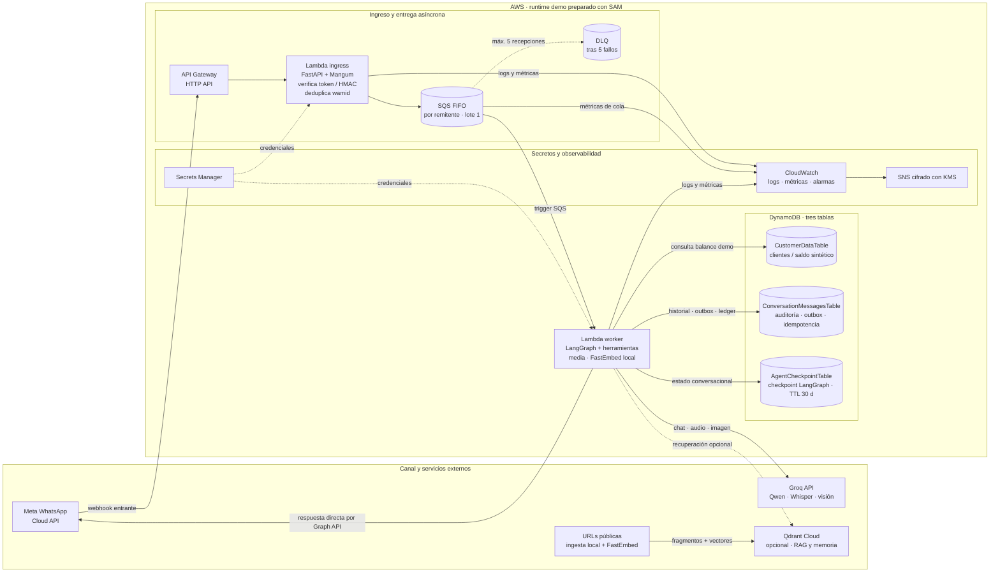

# Collections agent prototype

Functional, channel-independent prototype for debt-management conversations. The local CLI,
Chainlit, Telegram, and WhatsApp webhook send normalized events through one LangGraph runtime.
The Meta webhook can run locally behind ngrok. The separate `aws-demo/` folder shows the AWS ingress
and the deployable AWS worker runtime. The branch keeps local development available while adding
the DynamoDB-backed AWS path.

The prototype deliberately keeps financial authority in a billing tool backed by SQLite. Its
offline scenario demo uses a fake chat model and requires no Groq, vector database, AWS, or
Telegram credentials. The `langchain-agent/` project contains the shared runtime, Groq-backed
knowledge agent, local Chroma RAG, optional customer-scoped Qdrant memory, and Chainlit UI.

## Quick start

```bash
uv sync --project langchain-agent
uv run --project langchain-agent python demo/run_demo.py
```

For tests and linting, install the optional development tools:

```bash
uv sync --project langchain-agent --extra local --extra dev
uv run --project langchain-agent --extra local --extra dev pytest
uv run --project langchain-agent --extra local --extra dev ruff check .
```

The demo prints representative scenarios: negotiation, confirmed promise, disputed balance,
unauthorized discount, human escalation, unknown client, tool failure, and opt-out.

## Project layout

```text
src/lla_agent/
  domain/       Business entities and channel-independent response types
  persistence/  SQLite local mock, DynamoDB adapter, and synthetic case seed
  tools/        consultar_saldo, registrar_promesa_pago, escalar_a_humano
  application/  Deterministic collection operations called by LangGraph
  channels/     Telegram and WhatsApp transport adapters
demo/           Offline executable conversation demo
tests/          Focused tool and decision tests
docs/           AWS architecture and assessment traceability
langchain-agent/ Optional Groq agent, web RAG pipeline, and Chainlit interface
aws-demo/       FastAPI/Mangum ingress, LangGraph worker image, and SAM infrastructure
```

## Telegram demo adapter

To run a real Telegram polling adapter, install its optional dependency and set secrets outside
source control:

```bash
uv sync --project langchain-agent --extra local --extra telegram
export TELEGRAM_BOT_TOKEN="..."
uv run --project langchain-agent --extra local --extra telegram python -m lla_langchain_agent.telegram
```

The Telegram runner opens one shared runtime for the polling process. It does not infer a
`client_id` from message text; add a trusted mapping from the Telegram external ID to a mock
client before account tools can return customer data. The WhatsApp adapter in
`src/lla_agent/channels/whatsapp.py` likewise requires a verified event and receives identity
context from its caller. No WhatsApp API token is included.

## Local LangChain and RAG demo

The separate [`langchain-agent/README.md`](langchain-agent/README.md) shows how to run the LangGraph
runtime and open the Chainlit interface. The process compiles one graph and keeps one SQLite
checkpointer open; each channel supplies a normalized event. The UI displays web extraction,
chunking, local embeddings, shared Chroma indexing, retrieval, source URLs, and tool outcomes.
Financial actions use the SQLite mock; a promise is written only after explicit confirmation.

## AWS architecture demo

[`aws-demo/README.md`](aws-demo/README.md) documents the AWS runtime: API Gateway, ingress Lambda,
SQS FIFO/DLQ, an agent worker Lambda, separate DynamoDB customer records, conversation audit/outbox,
and LangGraph checkpoints, Secrets Manager, Groq, CloudWatch alarms, and optional Qdrant. The worker
runs the same LangGraph workflow and WhatsApp text/audio/image normalizer as the local webhook. Its
idempotency ledger reuses saved replies on retry and pauses a sender after ambiguous delivery; Meta
send outcomes that cannot be confirmed require manual reconciliation. SAM build and validation do
not create AWS resources; deploying the template does.

### AWS architecture overview



La Lambda worker responde directamente por Graph API; la rama no tiene una cola de envíos separada ni procesa callbacks de estado de entrega. `SEND_UNKNOWN` requiere conciliación manual. Las tablas de clientes contienen datos sintéticos: no son una integración productiva de facturación.

El [README de AWS](aws-demo/README.md#diagrama-general-de-la-arquitectura) amplía los pasos de
vinculación de cliente y RAG. La [evidencia de arquitectura AWS](docs/aws-deployment-evidence.md)
incluye los demás flujos, límites y decisiones de persistencia.

[`docs/aws-deployment-evidence.md`](docs/aws-deployment-evidence.md) diagrams this branch’s webhook,
LangGraph, QA client linking, DynamoDB memory, website RAG/embeddings, semantic memory, media,
delivery retries, and deployment flows. It also separates SAM declarations from the live endpoint
check made during this session.

## Conversation examples

The agent requires a validated client identity before disclosing a balance. In the demo, the
validated identity is represented by `client_id="C001"`:

- “Quiero pagar en dos semanas” → reads the current billing balance and offers a promise.
- `confirmo propuesta 1250.00 2026-11-15` → registers only the pending proposal with that exact amount and date.
- “No reconozco este saldo” → reads the billing balance, then escalates the dispute.
- “Aplícame un descuento no autorizado” → does not invent or apply a discount; escalates.
- “Hablar con un asesor” → escalates with a summary.
- “STOP” / “no me contacten” → records opt-out and sends no further collection content.

Deterministic collection operations remain the auditable business boundary called by the LangGraph
workflow. Groq's `create_agent` subgraph handles general questions with scoped customer lookup, RAG
over public pages, and client-scoped nonfinancial memory. Local collection actions use SQLite; the
AWS runtime uses DynamoDB. Conversation checkpoints use a stable hashed thread ID scoped by channel
and WhatsApp sender, so linking an ID does not split the conversation.

## Configuration and limitations

- `LLA_DB_PATH` controls the SQLite file (default: `./data/collections.sqlite3`).
- No secrets are hardcoded. Telegram requires `TELEGRAM_BOT_TOKEN` only for that adapter.
- Local mock data is not production financial data.
- The prototype has no real payment gateway, CRM, identity provider, or campaign scheduler. The
  AWS runtime and template are prepared but have not been deployed. The local WhatsApp webhook uses
  the three AVA variables plus the existing Groq key;
  it can receive text, audio, and images through ngrok, but inbound POST signatures are not
  validated. The LangChain/Groq inference is for local demonstration with mock customer data.
- The SQLite repository demonstrates interfaces and idempotency concepts; production must use
  the AWS services and controls in `docs/architecture.md`.
- The prototype responds in Spanish, matching the assessment context.

## Documents

- [`docs/architecture.md`](docs/architecture.md): 100% AWS production design, controls, risks,
  operations, and assumptions.
- [`docs/superpowers/specs/2026-11-03-aws-architecture-demo-design.md`](docs/superpowers/specs/2026-11-03-aws-architecture-demo-design.md): scope and diagram for the AWS-only architecture demo.
- [`docs/superpowers/specs/2026-11-03-dynamodb-whatsapp-runtime-design.md`](docs/superpowers/specs/2026-11-03-dynamodb-whatsapp-runtime-design.md): DynamoDB, LangGraph checkpoints, Groq, and Qdrant runtime design.
- [`docs/superpowers/specs/2026-11-03-whatsapp-delivery-reliability-design.md`](docs/superpowers/specs/2026-11-03-whatsapp-delivery-reliability-design.md): message idempotency, outbox, sender locks, delivery uncertainty, and alarms.
- [`docs/superpowers/plans/2026-11-03-whatsapp-delivery-reliability.md`](docs/superpowers/plans/2026-11-03-whatsapp-delivery-reliability.md): implementation tasks and verification constraints.
- [`docs/assessment-compliance.md`](docs/assessment-compliance.md): requirement-by-requirement
  mapping and explicit simulations.
