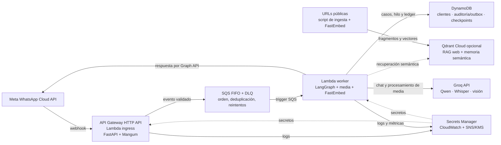
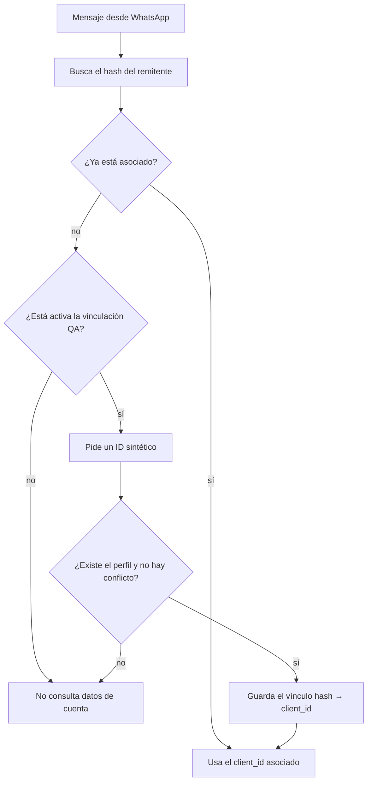
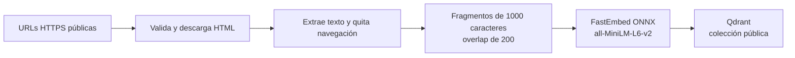
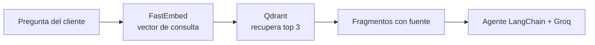

# Agente de WhatsApp en AWS

Esta rama conecta el agente LangGraph que se usa localmente con el flujo:

`Meta WhatsApp → API Gateway → Lambda ingress → SQS FIFO/DLQ → Lambda worker → Groq y DynamoDB`

Aquí se muestran el diagrama general y los flujos principales de esta rama. La
[evidencia de arquitectura AWS](../docs/aws-deployment-evidence.md) contiene el detalle ampliado,
incluido el webhook, LangGraph, memoria, media, reintentos y despliegue.

## Diagrama general de la arquitectura



El webhook entra por API Gateway y Lambda; el worker responde de forma asíncrona después de consumir
SQS. El worker consulta los tres almacenes DynamoDB y Groq. Qdrant es opcional: FastEmbed vectoriza
las páginas en el equipo que ejecuta la ingesta y las consultas dentro del worker; no se usa la API
de embeddings de Groq. Los mensajes de respuesta salen por Meta Graph API.

## Vinculación del número con un cliente de QA



`EnableDemoIdLinking` está apagado por defecto. El ID debe corresponder a un perfil sintético
existente; esta asociación sirve para QA y no autentica clientes reales.

## Ingesta y recuperación RAG



La ingesta la ejecuta un operador con `aws-demo/scripts/index_public_pages.py`. Cada fragmento
conserva su URL y título para que el agente pueda citar las fuentes.



El corpus web y la memoria semántica del cliente usan colecciones Qdrant separadas. Las consultas
de cobranza siguen leyendo saldos y facturas desde DynamoDB, no desde el RAG.

El worker usa el mismo agente, las mismas reglas de cobranza y el mismo adaptador para texto, audio
e imágenes. Groq sigue siendo el modelo de lenguaje. El diseño conserva por separado el estado de
negocio, el historial visible, los checkpoints y el trabajo pendiente:

| Componente | Qué guarda | Retención / función |
|---|---|---|
| `CustomerDataTable` | Casos, perfiles, servicios, facturas, eventos de cobranza y vínculos de identidad. | Datos de negocio; no contiene el transcript nuevo. |
| `ConversationMessagesTable` | Mensajes auditados, respuestas del outbox y estado de idempotencia por `wamid`. | TTL de 90 días para auditoría/ledger; el bloqueo activo por remitente no tiene TTL. |
| `AgentCheckpointTable` | Estado serializado de LangGraph asociado al hilo con ID hasheado. | TTL de 30 días. |
| Qdrant (opcional) | RAG de páginas públicas y recuerdos semánticos seleccionados y seguros por cliente. | No es el historial de mensajes. |
| SQS FIFO y DLQ | Eventos entrantes que esperan procesamiento o revisión. | Cola de trabajo, no memoria de conversación; la cola principal retiene 4 días y la DLQ 14 días. |

## Qué recuerda y dónde

- **Casos y verificación del ID:** `CustomerDataTable` guarda perfiles, servicios, facturas, eventos
  de cobranza y el vínculo de identidad. Cuando el cliente envía un ID, el workflow exige que el
  perfil exista antes de asociarlo al remitente. Un remitente asociado no puede cambiarse a otro
  perfil desde el chat.
- **Historial visible y entrega:** `ConversationMessagesTable` almacena los mensajes de auditoría y
  los estados de entrega. El ledger usa el hash del `wamid`; las claves no guardan el número del
  remitente. El texto auditado y las respuestas guardadas caducan en 90 días. El bloqueo del turno
  activo usa un hash del remitente, no guarda el teléfono y no caduca automáticamente.
- **Contexto de LangGraph:** `AgentCheckpointTable` guarda el estado asociado a un ID de hilo
  derivado del canal y del remitente. El resumen del historial permite limitar el contexto guardado.
  Los checkpoints caducan después de 30 días.
- **Memoria a largo plazo y RAG:** Qdrant permanece separado de DynamoDB. Si no configuras Qdrant,
  las consultas de cuenta siguen funcionando, pero no se usa la búsqueda web ni la memoria semántica.
  El RAG público usa la colección `lla_public_web_pages_fastembed_v1`; la memoria de cliente usa
  `lla_customer_memories_fastembed_v1`.
- **Trabajo pendiente:** SQS entrega al menos una vez. El worker confirma los mensajes completados;
  los fallidos pasan a la DLQ tras cinco recepciones. Los logs no contienen cuerpos, teléfonos,
  tokens ni IDs del proveedor.

## Requisitos

- AWS SAM CLI y Docker
- AWS CLI autenticado en la región de despliegue
- Dos secretos JSON de WhatsApp, uno de Groq y, opcionalmente, uno de Qdrant en Secrets Manager
- Un número de WhatsApp Cloud API asociado a una aplicación y suscrito al webhook `messages`
- Una cuenta Qdrant con el índice creado, si activarás RAG o memoria semántica

El código no despliega recursos ni lee credenciales del equipo. El worker usa el rol de ejecución de
Lambda para acceder a DynamoDB y Secrets Manager. Las claves no se deben pegar en el template, en
`samconfig.toml` ni en el repositorio.

## Secretos requeridos

Crea los secretos desde AWS Secrets Manager. Guarda cada valor como JSON:

```json
{
  "app_secret": "secreto-de-la-aplicacion-meta",
  "verify_token": "token-aleatorio-del-webhook"
}
```

El token de envío va en un secreto separado:

```json
{
  "access_token": "token-de-whatsapp-cloud-api"
}
```

El secreto de Groq tiene esta forma:

```json
{
  "api_key": "clave-de-groq"
}
```

El secreto opcional de Qdrant puede guardar también la URL para mantenerla junto a la clave:

```json
{
  "url": "https://tu-cluster.region.aws.cloud.qdrant.io:6333",
  "api_key": "clave-de-qdrant"
}
```

Anota los ARN. En AWS, el token largo de WhatsApp necesita `whatsapp_business_messaging` y debe
seguir vigente; no reutilices los tokens de prueba que ya fueron compartidos en chats.

## Validar y construir sin desplegar

Desde esta carpeta:

```bash
sam validate --lint --template-file template.yaml
sam build --use-container --template-file template.yaml
```

`sam build` crea imágenes locales. El worker instala solo las dependencias del runtime de AWS y
FastEmbed/ONNX para vectorizar; no instala Chainlit, Chroma, PyTorch ni Sentence Transformers. Los
pesos del modelo se descargan a `/tmp/fastembed` cuando se activa Qdrant. Estos comandos no crean
recursos en AWS.

## Desplegar cuando estés listo

Primero confirma que AWS CLI apunta a la región correcta y que el rol puede crear CloudFormation,
roles IAM, Lambda, API Gateway, SQS, DynamoDB, CloudWatch, SNS, llaves KMS y repositorios ECR. Luego,
desde `aws-demo/`:

```bash
sam deploy --guided
```

En el asistente selecciona la región, autoriza a SAM a crear los roles y parámetros, y pasa:

- `WhatsAppWebhookSecretArn`
- `WhatsAppAccessTokenSecretArn`
- `GroqApiKeySecretArn`
- `WhatsAppPhoneNumberId`
- `QdrantSecretArn` y `QdrantUrl`, si usarás Qdrant
- `AlarmNotificationEmail`, si quieres recibir avisos por email
- `EnableDemoIdLinking=true` solo para perfiles sintéticos de QA

SAM crea tres tablas DynamoDB, dos funciones Lambda de imagen, el API HTTP, la cola FIFO, la DLQ,
grupos de logs, alarmas CloudWatch, un topic SNS cifrado con una llave KMS propia y, si se indicó, la
suscripción de email. El despliegue escribe las imágenes a ECR. Las tablas usan pago por solicitud,
cifrado administrado por DynamoDB y recuperación a un punto en el tiempo. Al terminar, toma
`CustomerDataTableName`, `ConversationMessagesTableName`, `AgentCheckpointTableName`,
`AlarmTopicArn` y `WebhookCallbackUrl` de los outputs de CloudFormation.

`AlarmNotificationEmail` es opcional. Si lo configuras, SNS enviará un mensaje de confirmación y la
suscripción no recibirá alarmas hasta que la confirmes. Las alarmas cubren: edad del mensaje más
antiguo (300 s), backlog visible (10), backlog en vuelo (10), cualquier mensaje en DLQ, fallos por
registro del worker, errores/throttles de Lambda y duración del worker de 100 s o más. El filtro de
logs `queue_message_failed` detecta fallos parciales aunque la invocación Lambda haya devuelto una
respuesta válida. El worker emite `queue_message_processing_started`, `agent_complete`,
`whatsapp_send_started`, `whatsapp_send_accepted` y `queue_message_failed`; los eventos llevan un
hash corto del `wamid`, el número de recepción, la etapa y los tiempos, nunca el texto, teléfono,
token o ID de Meta.

Las tablas y la llave KMS usan `DeletionPolicy: Retain`. Borrar la pila no borra esos recursos ni sus
datos; la llave KMS retenida puede seguir generando cargos. DynamoDB PITR, alarmas CloudWatch, uso de
SNS/KMS, Lambda, SQS y ECR también pueden generar costos al desplegarse. No se ha desplegado esta
versión desde aquí.

## Cargar perfiles de demostración

Después del despliegue, desde la raíz del repo y con AWS CLI autenticado:

```bash
uv sync --project langchain-agent --extra aws
uv run --project langchain-agent --extra aws \
  python aws-demo/scripts/seed_demo_cases.py \
  --table-name NOMBRE_DE_CUSTOMERDATATABLE \
  --region us-east-2
```

La carga es idempotente y no sobrescribe registros existentes. Usa únicamente los casos sintéticos
`1234`, `5678`, `9012`, `C001`, `C002`, `C003` y `CERR`.

## Indexar las páginas públicas del RAG

Exporta `QDRANT_URL` y `QDRANT_API_KEY` en tu terminal sin guardarlos en el repo, y desde la raíz:

```bash
uv sync --project langchain-agent --extra ingest
uv run --project langchain-agent --extra ingest python aws-demo/scripts/index_public_pages.py \
  https://libertynetworks.com/es \
  https://libertynetworks.com/es/soluciones-de-negocio/banca-y-finanzas \
  https://libertycr.com/web/legal/terminos-y-condiciones
```

Este comando extrae el texto público, lo divide en fragmentos y genera vectores con FastEmbed/ONNX
usando `sentence-transformers/all-MiniLM-L6-v2`. Reemplaza la colección pública
`lla_public_web_pages_fastembed_v1`; la ingesta se hace desde tu equipo, no desde Lambda. La nueva
colección evita mezclar vectores de la implementación anterior con los de FastEmbed. El secreto de
Qdrant del worker debe apuntar al mismo cluster.

La memoria semántica usa otra colección, `lla_customer_memories_fastembed_v1`. Si ya había datos en
`lla_customer_memories`, quedan intactos y el agente empieza una colección nueva, vacía.

## Configurar Meta y probar

1. Copia el output `WebhookCallbackUrl` en la configuración del webhook de Meta.
2. Usa el mismo `verify_token` almacenado en el secreto y suscribe el campo `messages`.
3. Si activaste Qdrant, primero indexa las páginas como se mostró arriba.
4. Envía `hola` al número: el worker debe contestar.
5. Para probar la vinculación QA, envía una consulta de cuenta, responde con `1234`, `5678` o `9012`,
   y luego pregunta por el saldo o las facturas.

Un ID por sí solo **no verifica identidad**. La opción `EnableDemoIdLinking` solo debe usarse con
estos datos ficticios. Para datos reales hay que añadir verificación por OTP u otro mecanismo
confiable antes de habilitar consultas financieras.

## Idempotencia, reintentos y estados de entrega

- Antes de normalizar el mensaje o llamar al agente, el worker reclama el `wamid` y bloquea el turno
  del remitente. `PROCESSING` representa la ejecución del agente; `REPLY_READY` conserva la respuesta
  ya generada; `SENDING` representa un envío iniciado; `SENT` registra el ID de Meta y libera el
  bloqueo. Un duplicado `SENT` se confirma sin volver a llamar a Groq ni a Meta.
- Una respuesta Meta `429` y un fallo de conexión comprobado antes de enviar la solicitud se pueden
  reintentar. El worker reutiliza el texto `REPLY_READY`, aplica visibilidad de 15, 30, 60, 120 y
  hasta 240 segundos, y deja que la política existente redirija los fallos agotados a la DLQ.
- Una respuesta Meta `408`/`5xx`, un timeout de lectura/escritura o un fallo de protocolo después de
  iniciar el envío queda en `SEND_UNKNOWN`. No se reenvía automáticamente porque Meta podría haber
  aceptado el mensaje. Los errores permanentes quedan en `FAILED`. Ambos estados conservan el bloqueo
  del remitente.
- Los mensajes posteriores de ese remitente no ejecutan el grafo, Groq ni el envío de Meta mientras
  el turno previo esté bloqueado; se reintentan sin trabajo externo y, si no se resuelve, llegan a la
  DLQ. Esto evita que el agente procese una conversación fuera de orden.
- Los fallos de audio/imágenes que no se pueden procesar reciben directamente el texto de guía y se
  auditan con etiquetas seguras como `[audio adjunto]` o `[imagen adjunta]`; no se guarda la URL ni el
  ID del archivo.
- La deduplicación de DynamoDB y SQS reduce los duplicados, pero no ofrece una transacción atómica
  entre DynamoDB y Meta. Un resultado ambiguo exige reconciliación manual.

## Recuperación ordenada de la DLQ

No redirijas una DLQ mientras el webhook siga enviando mensajes. AWS mueve los mensajes de la DLQ
del más antiguo al más nuevo, pero los nuevos mensajes de productores activos pueden intercalarse en
la cola de destino ([documentación de redrive de SQS](https://docs.aws.amazon.com/AWSSimpleQueueService/latest/SQSDeveloperGuide/sqs-configure-dead-letter-queue-redrive.html)).

1. Pausa temporalmente el ingreso de Meta (desactiva el webhook o la ruta de ingreso durante la
   ventana de mantenimiento).
2. Deja el worker habilitado para vaciar la cola FIFO. Espera hasta que la cola principal tenga cero
   mensajes visibles y cero mensajes en vuelo; los turnos bloqueados deben haber llegado a la DLQ.
3. Deshabilita el event source mapping SQS del worker y confirma que no quede una invocación en curso.
4. Inicia un redrive de todos los mensajes de la DLQ de vuelta a la cola principal vacía. Espera a que
   termine la tarea antes de reactivar consumidores o ingreso.
5. Para cada remitente, revisa el primer mensaje bloqueador. Corrige la causa de `FAILED` y elige si
   puede reutilizarse la respuesta guardada (`REPLY_READY`) o debe volver a procesarse (`PROCESSING`).
   Actualiza el ledger y el bloqueo con una operación transaccional: no cambies solo una fila desde
   la consola de DynamoDB.
6. Para `SEND_UNKNOWN`, revisa el historial de mensajes de Meta y confirma si se entregó. Marca
   `SENT` solo si hay confirmación; permite un nuevo envío solo cuando puedas confirmar que Meta no lo
   aceptó. Si no se puede determinar, mantén bloqueado el remitente y coordina la respuesta humana.
7. Inspecciona los mensajes poison y sus filas `POISON#<hash>`. SQS no permite editar un mensaje en
   sitio: elimina la entrada inválida y vuelve a publicar una entrada corregida con el mismo grupo
   FIFO si puede reconstruirse; si no, descártala solo por decisión del operador. Quita su bloqueo
   únicamente después de confirmar que no quedan turnos anteriores o pendientes sin procesar.
8. Habilita el worker y espera a que procese el backlog redirigido en orden. Reanuda el ingreso de
   Meta después de que la cola de recuperación esté vacía.

## Limitaciones operativas

- Qdrant es un servicio externo y puede generar costos separados. Sin su secreto, la búsqueda web y
  la memoria semántica se desactivan sin bloquear las herramientas de cobranza en DynamoDB.
- Los mensajes de auditoría se conservan 90 días, los checkpoints 30 días y SQS conserva pendientes y
  DLQ según las retenciones de la plantilla. El resumen del grafo limita el historial activo de
  LangGraph, pero no sustituye estas retenciones.
- `sam deploy --guided` crea recursos facturables. La documentación y la plantilla están listas para
  revisión; esta implementación no se ha desplegado desde aquí.
