# Evidencia de arquitectura AWS — rama `aws-deployment`

**Actualizado:** 2026-11-03
**Alcance:** implementación que existe en el código de esta rama. Este documento separa el diseño
de los recursos declarados por SAM y de lo que se pudo observar en el endpoint compartido.

## Estado comprobable

- `aws-demo/template.yaml` declara API Gateway HTTP API, dos Lambdas en imágenes de contenedor,
  SQS FIFO con DLQ, tres tablas DynamoDB, Secrets Manager y alarmas de CloudWatch.
- El worker sí integra el runtime LangGraph/Groq, el repositorio DynamoDB y el envío de mensajes a Meta.
- La URL de API Gateway que compartiste respondió `200` en `/health` con `mode=architecture-demo`
  durante esta sesión. Esto demuestra que el endpoint respondió; no demuestra qué versión del worker
  está desplegada ni que un mensaje haya atravesado la cola.
- No ejecuté `sam deploy` ni pude leer CloudFormation o CloudWatch porque la sesión local de AWS CLI
  expiró. Por eso los diagramas describen la rama; la versión activa del stack y los logs requieren
  una comprobación autenticada.

## Arquitectura general

El ingreso de WhatsApp termina rápido al aceptar el mensaje en SQS. El trabajo costoso —LangGraph,
Groq, lecturas DynamoDB, RAG opcional y respuesta por Graph API— sucede en el worker asíncrono.

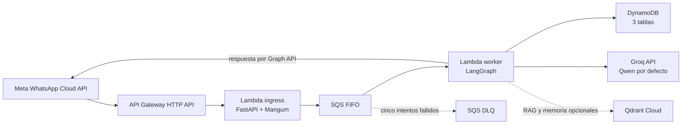

**AWS:** API Gateway, Lambda, SQS, DynamoDB, Secrets Manager, CloudWatch, SNS y KMS.
**Externos:** Meta Cloud API, Groq y, si se configura, Qdrant Cloud. FastEmbed ejecuta la generación
de vectores dentro del proceso que indexa o consulta; no es un endpoint de embeddings de Groq.

La plantilla no implementa Aurora, S3 como almacén RAG, Bedrock, AgentCore Memory, Amazon Transcribe
o EventBridge Scheduler. Esos servicios aparecen en diseños anteriores, pero no son dependencias
del runtime AWS actual de esta rama.

## Recorrido de un mensaje

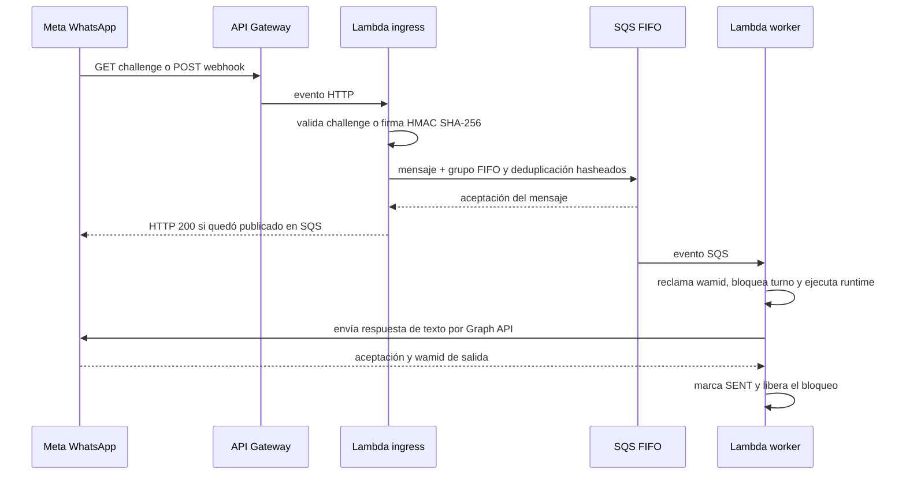

El `200` del webhook solo confirma que el ingreso aceptó el evento en la cola. No confirma que
Groq haya respondido ni que Meta haya aceptado la respuesta saliente. El punto de confirmación de
salida es `whatsapp_send_accepted` seguido por el estado `SENT` en DynamoDB.

### Validaciones de ingreso

1. `GET /health` responde el estado del servicio.
2. `GET /webhook` compara `hub.verify_token` con el valor de Secrets Manager y devuelve el challenge
   de Meta solo cuando `hub.mode=subscribe` y el token coincide.
3. `POST /webhook` valida `X-Hub-Signature-256` usando el `app_secret` y HMAC SHA-256.
4. El handler extrae `sender`, `wamid` y el mensaje, y publica el evento en SQS FIFO.
5. El grupo FIFO se deriva del hash del remitente; la clave de deduplicación, del hash del `wamid`.
   Así se conserva el orden por WhatsApp y se reduce el reprocesamiento de entregas duplicadas.

El sobre temporal de SQS contiene el remitente, el ID de Meta y el contenido del mensaje para que
el worker pueda procesarlo. SQS usa cifrado del lado del servicio y permisos IAM limitados; las
claves de identidad en DynamoDB usan hashes. Los callbacks de estado de entrega que Meta también
puede enviar no se guardan en esta implementación: `SENT` significa que Graph API aceptó la
respuesta, no confirma entrega ni lectura por el destinatario.

El código de ingreso está en [webhook.py](../aws-demo/src/aws_demo/webhook.py).

## Flujo LangGraph y decisiones del agente

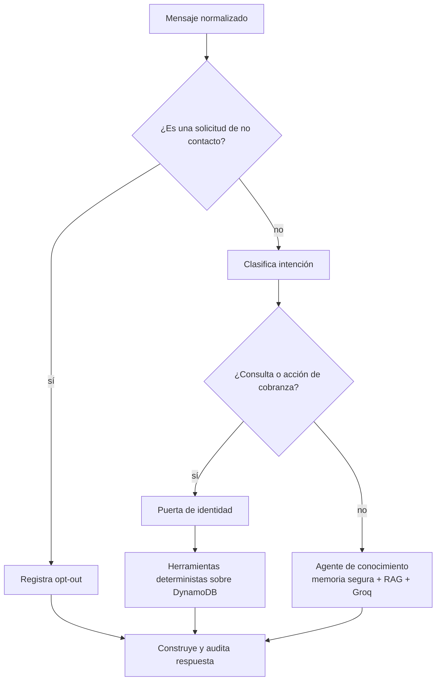

- Las rutas de cobranza consultan el repositorio y no usan el RAG para calcular saldos. Las
  operaciones deterministas cubren saldo, facturas, promesas, disputas, escalamiento y opt-out.
- La ruta de conocimiento usa `create_agent` con Groq, `consultar_contexto_cliente` para datos
  autorizados y `buscar_en_paginas` para las páginas públicas indexadas.
- Si no hay un `client_id` validado, la puerta de identidad evita llamar herramientas que revelen
  datos financieros.
- Después de 20 mensajes, el grafo puede resumir contexto antiguo y conservar los últimos 8 mensajes.
  El filtro omite contenido que parezca financiero o identificable; el resumen no es fuente de saldos.

Implementación: [workflow.py](../langchain-agent/src/lla_langchain_agent/workflow.py),
[agent.py](../langchain-agent/src/lla_langchain_agent/agent.py) y
[business.py](../src/lla_agent/tools/business.py).

## Vinculación del remitente con un cliente

El remitente de WhatsApp se convierte en un identificador externo estable (`whatsapp:<sender>`).
El teléfono no se usa como clave en DynamoDB: el repositorio deriva un SHA-256 para buscar o escribir
la relación `EXTERNAL#<hash> → client_id`.

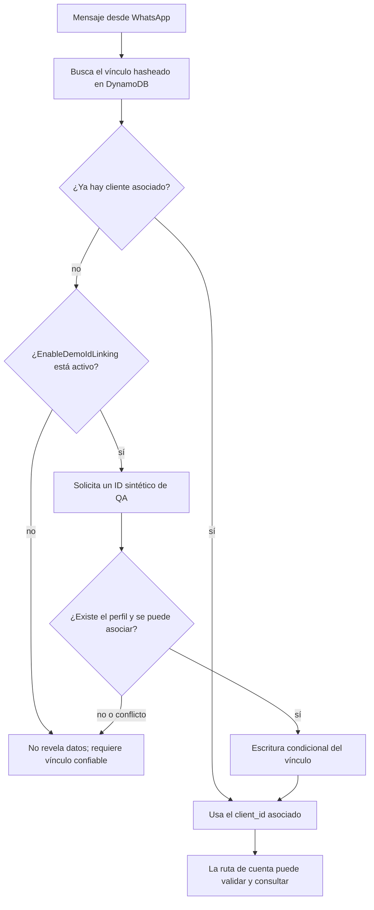

- `EnableDemoIdLinking` está en `false` por defecto. Cuando se activa para QA, el agente acepta
  un ID sin texto adicional solo después de haberlo solicitado; los perfiles sintéticos incluyen
  `1234`, `5678`, `9012`, `C001`, `C002`, `C003` y `CERR` (`CERR` simula una indisponibilidad de
  facturación).
- `link_client_to_external_id` exige que el perfil exista. La escritura condicional impide que dos
  conversaciones reemplacen el vínculo; si el WhatsApp ya apunta a otro perfil, el agente rechaza
  el cambio desde el chat.
- El ID compartido en el chat sirve como atajo de demostración, **no autentica a una persona**.
  Para clientes reales hace falta OTP u otro mecanismo confiable; esta rama no implementa ese flujo.
- Al terminar la asociación, el hilo de conversación conserva el mismo identificador porque se
  deriva del canal y del remitente, no del `client_id`.

Código: [dynamodb.py](../src/lla_agent/persistence/dynamodb.py),
[whatsapp.py](../src/lla_agent/channels/whatsapp.py) y la puerta de identidad en
[workflow.py](../langchain-agent/src/lla_langchain_agent/workflow.py).

## Conversación, auditoría y memoria

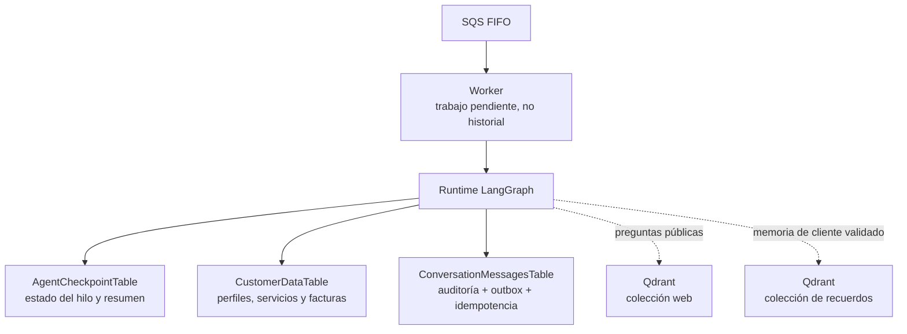

| Almacén | Qué contiene | Retención definida en código/plantilla |
|---|---|---|
| `CustomerDataTable` | Perfil, servicios, facturas, promesas, escalaciones, opt-out y vínculo de identidad. | TTL habilitado a nivel de tabla; los registros se eliminan solo si tienen `expires_at`. |
| `ConversationMessagesTable` | Mensajes de auditoría y texto de respuesta guardado, estados de entrega y bloqueo activo. | Filas de auditoría/ledger: 90 días. El bloqueo de turno no tiene TTL. |
| `AgentCheckpointTable` | Estado serializado de LangGraph por hilo con identificador hasheado. | 30 días (`2592000` segundos). |
| Qdrant, colección web | Fragmentos de páginas públicas y metadatos de fuente. | No hay TTL implementado por esta rama. |
| Qdrant, memoria cliente | Recuerdos semánticos permitidos, particionados por `client_id`. | No hay TTL implementado por esta rama. |
| SQS FIFO y DLQ | Trabajo pendiente y mensajes que requieren revisión/reintento. | 4 días en cola principal; 14 días en DLQ. |

El historial de conversación, los checkpoints y la memoria semántica son capas distintas. SQS es
transporte de trabajo, no memoria. `ConversationMessagesTable` conserva cuerpos auditados, así que
el TTL de 90 días también es relevante para revisar la retención de texto conversacional.

El `thread_id` de LangGraph es un hash estable de canal y conversación. La memoria de largo plazo
solo se consulta cuando el cliente existe y está asociado. El prompt de extracción instruye a Groq
a proponer recuerdos breves de preferencia, contexto general o seguimiento, excluyendo nombres,
datos de contacto, identificadores y datos financieros. Un filtro local adicional rechaza términos
de credenciales y finanzas, códigos y patrones de tarjetas; no es un sistema general de prevención
de fuga de datos. Los recuerdos guardan `client_id`, categoría, ID estable y fecha de creación. La
búsqueda siempre filtra por `metadata.client_id`.

Código: [runtime.py](../langchain-agent/src/lla_langchain_agent/runtime.py),
[memory.py](../langchain-agent/src/lla_langchain_agent/memory.py) y
[message_store.py](../aws-demo/src/aws_demo/message_store.py).

## RAG de páginas web y embeddings

### 1. Ingesta: URL → fragmentos → vectores

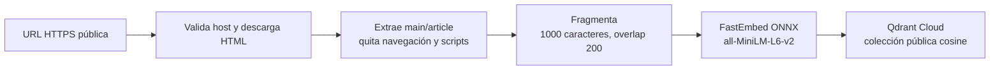

El operador ejecuta [index_public_pages.py](../aws-demo/scripts/index_public_pages.py) desde su
equipo. El cargador admite hasta 5 URLs HTTPS, bloquea destinos locales/no públicos, limita HTML a
2 MB y texto a 100 000 caracteres por página, sigue redirecciones de forma validada y guarda URL,
título, índice del fragmento y offset. `QdrantWebCorpus.replace` reemplaza la colección pública
completa en cada ingesta.

El vectorizador `FastEmbedEmbeddings` usa el modelo ONNX `sentence-transformers/all-MiniLM-L6-v2`.
La creación del vector no llama a Groq ni necesita una API key de embeddings. El índice remoto usa
`lla_public_web_pages_fastembed_v1` y distancia coseno. El mismo modelo se carga en el worker para
vectorizar la consulta; el cache se guarda bajo `/tmp/fastembed`.

### 2. Consulta: pregunta → recuperación → respuesta

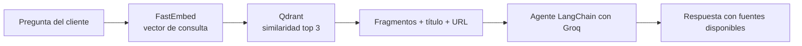

`buscar_en_paginas` devuelve hasta 3 coincidencias y limita cada fragmento enviado al agente. El
agente usa sus URLs como fuentes y el contenido web se trata como dato no confiable; no autoriza
consultas financieras ni puede cambiar reglas del agente.

### 3. Memoria semántica del cliente

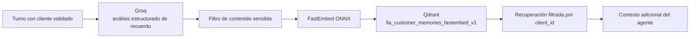

La memoria semántica no almacena el transcript ni saldos. Si Qdrant no está configurado, las
consultas de negocio sobre DynamoDB siguen disponibles, pero las colecciones web y de recuerdos no
aportan resultados. La memoria persistente de Qdrant no tiene expiración automática en esta rama.

En modo local existe otra ruta: Chroma persistente con embeddings de Hugging Face. El worker AWS
usa Qdrant y FastEmbed; son caminos separados y no se debe mezclar una colección generada por un
modelo de embeddings diferente.

## Audio e imágenes

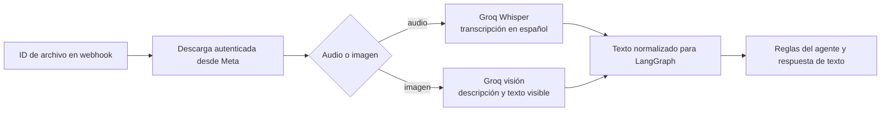

El código aplica límites de tamaño y tipos MIME admitidos. La transcripción/descripción se trata
como contenido del cliente, no como instrucción confiable ni prueba de identidad. Si no se puede
procesar el adjunto, la auditoría usa `[audio adjunto]` o `[imagen adjunta]`, sin guardar URL ni ID
de archivo.

## Idempotencia, orden y entrega

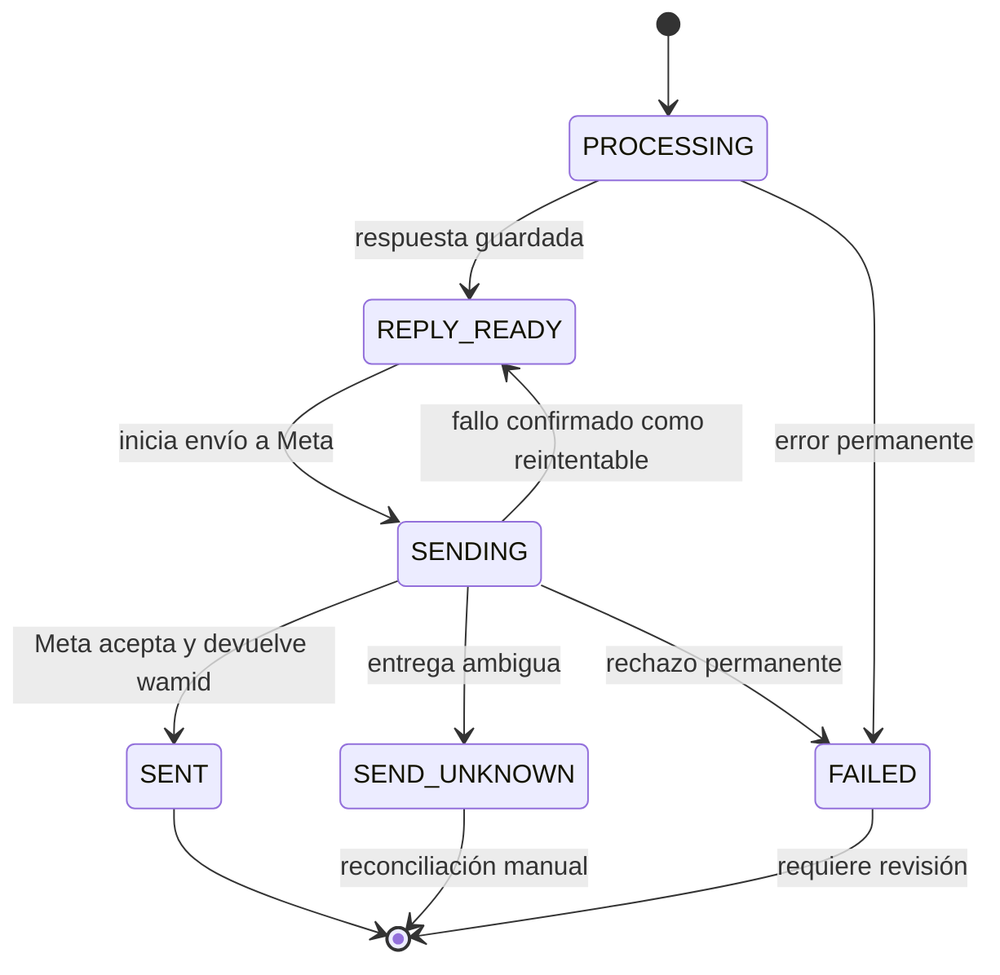

- El ledger reclama el `wamid` antes de ejecutar el grafo y mantiene un bloqueo por remitente para
  serializar turnos.
- Si el mensaje ya está `SENT`, un duplicado no vuelve a llamar a Groq ni a Meta.
- Ante `429` o un fallo de conexión comprobado antes de enviar, se vuelve a `REPLY_READY` y se
  reutiliza la respuesta guardada. Los reintentos usan visibilidad de 15, 30, 60, 120 y hasta 240
  segundos; SQS mueve mensajes agotados a DLQ después de 5 recepciones.
- Un `408`, `5xx` o timeout después de iniciar el envío se marca `SEND_UNKNOWN`: Meta podría haber
  aceptado el mensaje. No se reenvía automáticamente. El estado requiere reconciliación manual.
- `FAILED` y `SEND_UNKNOWN` conservan el bloqueo del remitente para evitar respuestas fuera de orden.
  Los estados ambiguos se resuelven con el runbook de recuperación de DLQ en
  [aws-demo/README.md](../aws-demo/README.md).

## Infraestructura, configuración y despliegue

| Recurso | Configuración declarada | Uso |
|---|---|---|
| API Gateway HTTP API | Rutas `/webhook` y `/health`; stage `$default`. | Callback de Meta. |
| Lambda ingress | Imagen Python 3.12, FastAPI/Mangum, 512 MB, timeout 30 s. | Verifica y encola. |
| SQS FIFO + DLQ | Cifrado administrado; FIFO por remitente; cola 4 días, visibilidad 720 s, DLQ 14 días, 5 recepciones. | Orden, reintentos y fallos. |
| Lambda worker | Imagen Python 3.12, 3008 MB, timeout 120 s, concurrencia reservada 2, batch size 1. | Runtime LangGraph, integración externa y salida. |
| DynamoDB | Tres tablas PAY_PER_REQUEST, cifrado y PITR. | Cliente, conversación/ledger y checkpoints. |
| CloudWatch | Grupos de log con retención de 7 días, filtro de fallos y alarmas. | Diagnóstico operativo. |
| SNS + KMS | Topic de alarma cifrado con llave rotatoria; email opcional requiere confirmar suscripción. | Notificación de alarmas. |

Los secretos se referencian por ARN y los roles Lambda tienen permisos acotados por recurso:

| Secreto | JSON requerido | Consumidor |
|---|---|---|
| WhatsApp webhook | `app_secret`, `verify_token` | Ingress y worker. |
| Token de envío WhatsApp | `access_token` | Worker. |
| Groq | `api_key` | Worker. |
| Qdrant, opcional | `api_key` y opcionalmente `url` | Worker. |

`WhatsAppPhoneNumberId` y `GroqModel` son parámetros de plantilla; el modelo por defecto es
`qwen/qwen3.8-27b`. No se guardan los valores secretos en Git, SAM template o logs.

### Secuencia de despliegue

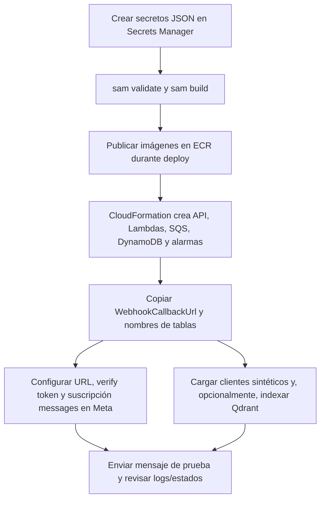

Pasos reproducibles y parámetros completos están en [aws-demo/README.md](../aws-demo/README.md).
`sam build` construye las imágenes localmente; `sam deploy --guided` crea recursos y puede generar
costos en Lambda, API Gateway, SQS, DynamoDB/PITR, CloudWatch, SNS/KMS y ECR.

### Alarmas y huella de logs

La plantilla alerta por antigüedad de la cola de 300 s, 10 o más mensajes visibles/en vuelo, al
menos un mensaje en DLQ, fallos por registro del worker, errores/throttles de Lambda y duración del
worker de 100 s o más. Un filtro de CloudWatch transforma `queue_message_failed` en métrica.

Los eventos del worker (`queue_message_processing_started`, `agent_complete`,
`whatsapp_send_started`, `whatsapp_send_accepted`, `queue_message_failed`) usan hash corto del
`wamid`, etapa, conteo de reintentos y duración. No registran cuerpo, teléfono o token. La tabla de
auditoría DynamoDB sí guarda el texto de los mensajes con TTL de 90 días.

## Mapa del código

| Parte | Archivo principal |
|---|---|
| Infraestructura SAM, IAM, parámetros, outputs y alarmas | [template.yaml](../aws-demo/template.yaml) |
| Webhook, firma Meta y publicación SQS | [webhook.py](../aws-demo/src/aws_demo/webhook.py) |
| Ejecución SQS, LangGraph, envío y reintentos | [worker.py](../aws-demo/src/aws_demo/worker.py) |
| Secretos Groq/Meta/Qdrant y runtime AWS | [agent_runtime.py](../aws-demo/src/aws_demo/agent_runtime.py) |
| Idempotencia, outbox y turnos por remitente | [message_store.py](../aws-demo/src/aws_demo/message_store.py) |
| Clientes, facturas, vinculación y registros | [dynamodb.py](../src/lla_agent/persistence/dynamodb.py) |
| Vectorización ONNX compartida | [embeddings.py](../langchain-agent/src/lla_langchain_agent/embeddings.py) |
| RAG remoto para Qdrant | [qdrant_rag.py](../langchain-agent/src/lla_langchain_agent/qdrant_rag.py) |
| Ingesta de URLs y chunking | [rag.py](../langchain-agent/src/lla_langchain_agent/rag.py) |
| Ingesta de páginas a Qdrant | [index_public_pages.py](../aws-demo/scripts/index_public_pages.py) |
| Runbook de configuración y operación | [aws-demo/README.md](../aws-demo/README.md) |
| Trazabilidad de requerimientos de evaluación | [assessment-compliance.md](assessment-compliance.md) |

## Cómo leer esta evidencia

1. El código y la plantilla describen la arquitectura prevista por la rama.
2. El `200` de `/health` confirma que el endpoint compartido respondió en la fecha anotada.
3. Para certificar un mensaje específico hace falta trazar el mismo `wamid` o su hash entre logs del
   ingress, SQS, worker y el estado de `ConversationMessagesTable`.
4. Un `200` del webhook no prueba entrega saliente; el evento `whatsapp_send_accepted` y el estado
   `SENT` registran que Meta aceptó la respuesta, no que el teléfono la recibió o leyó. Esta rama
   todavía no procesa callbacks de estado de Meta.
5. La salida del worker es únicamente un mensaje de texto de hasta 4096 caracteres; el código no
   implementa envío de plantillas de WhatsApp.
6. La consola/CLI de AWS debe estar autenticada antes de documentar estado vivo de CloudFormation,
   profundidad de colas, DLQ o CloudWatch.
