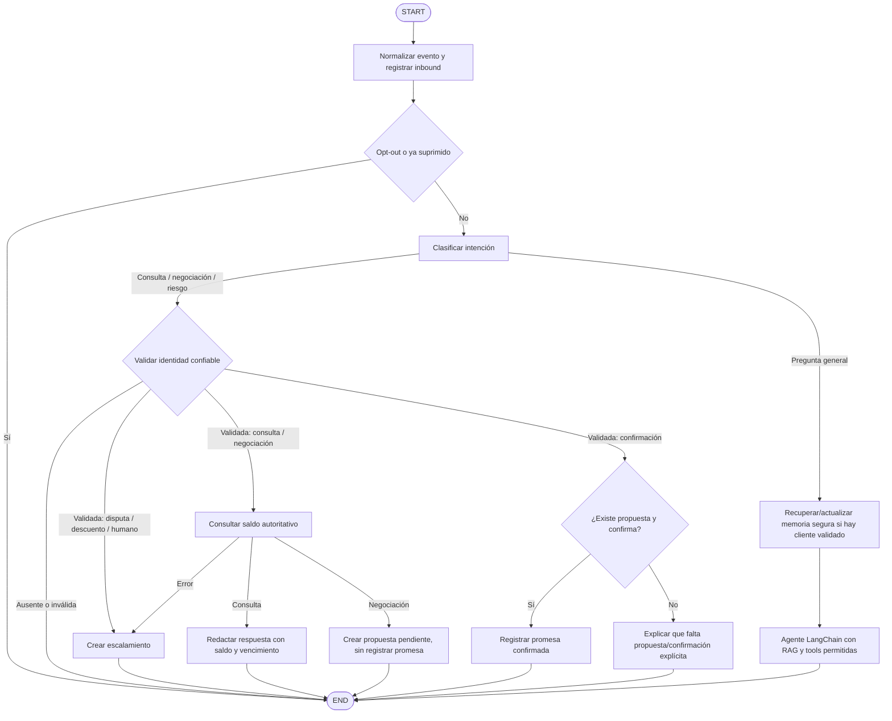

# Diseño: flujo de cobranza con LangGraph

## Objetivo

Incorporar un `StateGraph` explícito al demo LangChain para que el flujo de cobranza tenga pasos visibles y auditables. El grafo aplicará opt-out e identidad antes de acceder a datos, consultará saldo desde SQLite, manejará negociación y confirmación de promesas, y escalará disputas, descuentos no autorizados, solicitudes humanas y errores. Las reglas de cobranza son deterministas; el subagente Groq con tools atiende preguntas generales y contexto web. El modelo no es autoridad para saldo ni escrituras financieras.

## Alcance de esta iteración

- Demo local con eventos normalizados; no incluye el webhook real de Meta.
- Mantener Groq y `create_agent` para el bucle de herramientas conversacional y preguntas sobre páginas indexadas.
- Usar `MessagesState` con checkpoint SQLite para historial de corto plazo por conversación.
- Usar Qdrant solo para recuerdos estables, no sensibles y aislados por cliente.
- Mantener SQLite mock y los límites de `BillingTool`, `PaymentsTool` y `EscalationTool`.
- Mantener las operaciones deterministas de `CollectionsAgent` como servicios llamados por LangGraph; el grafo es el único router de mensajes.

## No objetivos

- Desplegar infraestructura AWS o configurar credenciales de Meta en esta iteración.
- Registrar pagos, autorizar descuentos o tratar recuerdos/RAG como fuente financiera.
- Añadir audio, imágenes, herramientas de AVA o campañas salientes.
- Reemplazar el origen de facturación real: SQLite sigue siendo mock para la demo.

## Flujo propuesto

## Reglas del flujo

1. `client_id` y `external_id` llegan como contexto confiable del adaptador, nunca como argumento elegido por el modelo ni parseado del mensaje. Para el demo, CLI y Chainlit pueden entregar el cliente mock seleccionado.
2. Procesar STOP/baja y revisar supresión antes del LLM, RAG o acceso al saldo.
3. La identidad se exige para rutas de cobranza/cuenta; el chat público con RAG sigue disponible sin cliente seleccionado. Pedir un identificador en el demo no equivale a verificación real de identidad.
4. La consulta de saldo usa `BillingTool`; Qdrant y Chroma no son autoridad financiera.
5. La negociación crea una propuesta pendiente. `PaymentsTool` solo registra cuando el mensaje repite exactamente el monto y la fecha de esa propuesta con el comando `confirmo propuesta <monto> <fecha>`; una respuesta corta o una propuesta antigua no basta.
6. Disputa, descuento no autorizado, solicitud humana y error de facturación crean escalamiento; el agente no modifica cargos.
7. El runtime calcula el `thread_id` como hash estable de canal, conversación y cliente; no incluye IDs externos ni teléfonos en claro. Al cambiar el cliente mock en Chainlit se abre otro hilo para no mezclar historiales.
8. Tras responder se persiste el outbound y se exponen al demo la intención, tools llamadas, resultado y escalamiento, sin incluir secretos.

## Estado y memoria

El estado del grafo extiende `MessagesState` con contexto de canal/cliente y resultados del turno (intención, saldo, propuesta, escalamiento y respuesta). `messages` usa el reducer de mensajes de LangGraph. El runtime conserva un checkpointer SQLite por proceso. Tras superar 20 mensajes, resume solo el contexto no financiero y recorta en un límite de turno completo, manteniendo al menos los últimos ocho mensajes; el repositorio de auditoría conserva la conversación completa. Qdrant sigue siendo memoria semántica entre conversaciones y siempre filtra por `client_id`.

El nodo de memoria se ejecuta solo después del opt-out; usa Qdrant únicamente cuando hay un cliente válido. Se conserva el filtro de contenido sensible de `QdrantCustomerMemory`. La memoria recuperada se inyecta como contexto no confiable, nunca como instrucción. El resumen del checkpointer también excluye identificadores y datos financieros y nunca reemplaza la consulta autoritativa de SQLite.

## Estructura prevista

- `langchain-agent/src/lla_langchain_agent/workflow.py`: estado, nodos, rutas condicionales y compilación del grafo.
- `langchain-agent/src/lla_langchain_agent/agent.py`: agente de conocimiento como subgrafo, con herramientas de lectura de cliente y RAG, más prompt dinámico para recuerdos.
- `src/lla_agent/application/agent.py` y `src/lla_agent/tools/business.py`: exponer operaciones deterministas reutilizables, sin un segundo router.
- `langchain-agent/src/lla_langchain_agent/runtime.py`: adaptar eventos normalizados a un grafo compilado una sola vez y administrar el ciclo de vida del checkpointer.
- `langchain-agent/src/lla_langchain_agent/cli.py` y `chainlit_app.py`: invocar el runtime con el mismo contrato.

## Alternativas consideradas

- **A. Grafo mínimo**: memoria y subgrafo `create_agent`; deja identidad y cobranza en el servicio determinista. Menor cambio, pero no representa el flujo completo en LangGraph.
- **B. Grafo de negocio (elegido)**: puertas de identidad/opt-out, rutas de cobranza, tools de lectura/escritura controlada, memoria y subgrafo de conocimiento. Mejora la trazabilidad de la prueba; requiere separar reglas compartidas para no duplicar lógica.
- **C. Reemplazar todo por un único agente con tools**: menos nodos, pero deja políticas críticas a decisiones del LLM y no hace explícito el control del flujo.

## Criterio para considerar lista esta iteración

El grafo debe poder recorrer los casos locales de consulta de saldo, negociación con propuesta pendiente, confirmación explícita, disputa, descuento no autorizado, solicitud humana, identidad ausente, error de facturación y opt-out. El mismo flujo debe ser invocable desde CLI y Chainlit, y las respuestas generales deben poder consultar RAG sin usarlo como autoridad de cobranza.

## Límite conocido

La integración real requiere una URL HTTPS pública, identidad confiable para Meta, verificación de firma del webhook, deduplicación de eventos, reintentos idempotentes distribuidos, envío por Cloud API y despliegue/configuración AWS. Todo queda para la siguiente etapa; el grafo tiene un contrato de entrada compatible, pero este adaptador no representa una conexión activa a WhatsApp.
