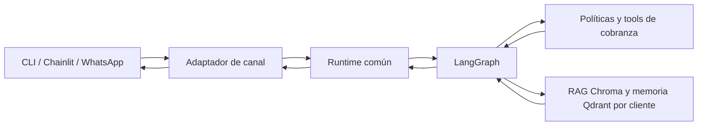

# Diseño: runtime común para el agente LLA

## Intención

Mejorar el funcionamiento del agente en las pruebas locales y dejar una ruta clara para conectarlo después a WhatsApp Business. CLI, Chainlit y el adaptador local de WhatsApp deben invocar el mismo runtime y el mismo grafo; las reglas de cobranza no deben duplicarse en cada canal. El adaptador WhatsApp se recorrerá localmente con mensajes ya normalizados/verificados; no habrá llamadas al webhook ni a la API de Meta.

## Lo que existe hoy

- El `StateGraph` implementa opt-out, identidad, consultas, promesas, escalamiento, memoria y preguntas generales con RAG.
- CLI y Chainlit usan el grafo, pero Chainlit construye el workflow y abre el checkpointer en cada turno.
- `CollectionsAgent.handle_message` conserva una segunda orquestación determinista. `WhatsAppAdapter` llama a ese método y evita el grafo.
- El estado de conversación usa SQLite y conserva mensajes completos. No hay resumen/recorte al crecer el historial.
- Qdrant ya aísla recuerdos por `client_id`; Chroma aporta el RAG de páginas web.
- El repositorio AVA separa nodos LangGraph, ofrece resumen de conversación, Chainlit y un endpoint FastAPI de WhatsApp. Su implementación es una referencia educativa; no se copiará su memoria sin filtro por cliente ni su webhook sin añadir verificación de firma y deduplicación.

## Enfoque elegido

Consolidar un runtime de aplicación reutilizable, con LangGraph como único orquestador. Mantenerlo primero local y pasarle un evento de entrada normalizado. CLI, Chainlit y el adaptador WhatsApp convierten el transporte a ese evento y entregan la respuesta al transporte.

## Objetivos

- Un solo punto de entrada de aplicación para cada turno, independientemente del canal.
- Compilar el grafo una vez por proceso y administrar el checkpointer durante el ciclo de vida del runtime, no abrir/cerrar conexiones en cada mensaje.
- Pasar `client_id`, `external_id`, canal e ID de mensaje como contexto confiable por turno; las tools deben leer el cliente del estado/runtime y no cerrar sobre el cliente seleccionado al compilar el grafo.
- Mantener el flujo de cobranza determinista y conservar SQLite como mock local.
- Conservar el aislamiento actual de memoria Qdrant por cliente y el carácter opcional del RAG.
- Resumir/recortar el historial de conversación cuando alcance un umbral, sin usar resúmenes ni recuerdos como autoridad financiera.
- Mantener una interfaz Chainlit que permita conversar, cambiar cliente mock y ver recuperación/tool outcomes.
- Hacer que `WhatsAppAdapter` invoque el runtime con un mensaje normalizado, para comprobar localmente el mismo flujo que se usará detrás del webhook.

## No objetivos de esta etapa

- Exponer un webhook Meta público, verificar firmas, enviar mensajes reales o desplegar en AWS.
- Añadir audio, imagen, campañas salientes o múltiples agentes especializados.
- Cambiar Groq, SQLite, Chroma o Qdrant.
- Copiar la memoria global de AVA; cada recuerdo sigue ligado a un cliente validado.

## Componentes y responsabilidades

### Adaptadores de canal

CLI, Chainlit y WhatsApp solo normalizan el mensaje entrante y sus metadatos confiables, invocan `AgentRuntime` y presentan/envían la respuesta. No contienen políticas de cobranza. El evento común incluye texto normalizado, `channel`, `message_id`, `external_id` y el `client_id` validado cuando exista. En esta etapa, `WhatsAppAdapter` recibe un `WhatsAppMessage` local ya verificado; la futura ruta HTTP de Meta queda separada.

### Runtime de aplicación

`AgentRuntime` recibe repositorio, checkpointer, grafo, stores y modelo por inyección de dependencias. Maneja la traducción del evento al estado/config de LangGraph, forma un `thread_id` estable y aislado por cliente/canal/conversación, ejecuta el grafo y devuelve respuesta más metadata de ejecución. El runtime no resuelve identidad a partir del texto.

### Grafo LangGraph

El grafo es la única capa que ordena el flujo: intake, opt-out, clasificación, identidad, ruta de cobranza o conocimiento, preparación de contexto y finalización. Los nodos devuelven actualizaciones parciales de estado. La identidad se valida antes de cualquier consulta de cuenta. Las escrituras de promesa siguen requiriendo una propuesta pendiente y el comando exacto que coincida con su monto y fecha.

### Servicios de dominio y tools

Las operaciones compartidas de saldo, propuesta, confirmación, escalamiento y persistencia permanecen fuera del LLM y del adaptador. `CollectionsAgent` deja de ser un segundo router; su API pública se conserva como una fachada compatible solo si delega al runtime común sin mantener otra implementación del flujo.

### Memoria y RAG

- SQLite checkpointer conserva el historial corto por thread.
- Un nodo de resumen reduce el historial visible al modelo al superar un umbral; los mensajes auditables no se eliminan de la tabla de mensajes.
- Qdrant guarda solo recuerdos no financieros, con filtro obligatorio por `client_id`; una caída de Qdrant deja el contexto vacío y permite continuar.
- Chroma conserva el corpus web local y opcional. Su contenido no autoriza acciones sobre cuentas.

## Límites y decisiones

- El `thread_id` debe usar un identificador estable y no debe incluir el número de teléfono en claro.
- El grafo compilado no puede capturar un cliente fijo en sus closures: herramientas y prompts deben obtener el cliente validado del estado de la ejecución.
- SQLite es apropiado para el demo de un proceso. El contrato del runtime debe permitir cambiar persistencia al preparar el despliegue, sin fingir que SQLite local es producción distribuida.
- La interfaz puede ofrecer una sesión local por usuario; la base Chroma sigue siendo un corpus público compartido de la demo, no almacena datos de clientes.
- Se mantiene el flujo de texto. Audio e imágenes de AVA pueden añadirse como normalizadores de entrada separados después.

## Opciones consideradas

1. **Mantener dos flujos** (grafo para CLI/Chainlit y `handle_message` para WhatsApp): cambio pequeño, pero permite que las reglas diverjan; descartado.
2. **Runtime común sobre el grafo** (elegido): consolida el flujo local y crea el punto de extensión para WhatsApp. Requiere sacar dependencias por cliente de las closures y ordenar el ciclo de vida del checkpointer.
3. **Copiar AVA y añadir webhook/multimodal ya**: aporta alcance de canal más rápido, pero mezcla la integración externa con la refactorización local y copiaría decisiones inseguras de la referencia; diferido.

## Criterios de aceptación

- CLI y Chainlit invocan `AgentRuntime`; el código de cobranza no contiene un segundo router de turnos.
- Un mismo grafo atiende distintos `client_id` sin mezclar tools, historial ni recuerdos.
- El runtime mantiene una conexión/checkpointer durante su ciclo de vida y proporciona thread IDs estables y separados.
- El historial enviado al modelo queda acotado con resumen, manteniendo los registros auditables en SQLite.
- El flujo local puede recorrer balance, propuesta, comando exacto de confirmación, disputa, opt-out, identidad ausente, RAG y degradación de Qdrant.
- El adaptador WhatsApp local invoca el runtime común; recibir/enviar mensajes con Meta queda fuera de esta etapa.

## Decisiones a cargo de implementación

- El hook concreto de ciclo de vida de Chainlit para construir/cerrar el runtime.
- El umbral y la ventana de mensajes para resumir, con el historial persistente separado.
- Si se mantiene `CollectionsAgent.handle_message` temporalmente como fachada de compatibilidad o se migra su consumidor local directamente.
- El formato interno de `InboundMessage` y `AgentReply`, manteniendo los campos de canal y trazabilidad requeridos.
