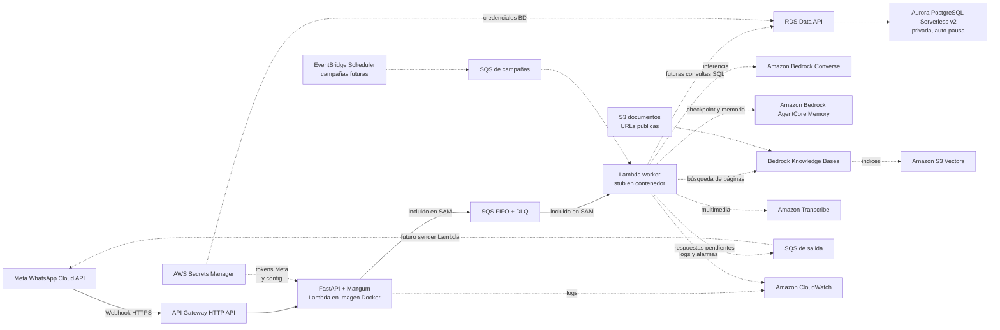

# Demo de arquitectura AWS para el agente de WhatsApp

**Estado:** alcance aprobado para demostración; no se aprovisionan recursos AWS en esta rama.

## Objetivo

Mostrar cómo podría funcionar el agente usando servicios AWS de punta a punta en su infraestructura,
con un flujo pequeño que se pueda construir como imagen Docker y describir mediante SAM. Esta rama es
un artefacto didáctico de arquitectura. No migra el runtime actual ni procesa conversaciones reales.

Meta WhatsApp Cloud API permanece como sistema externo obligatorio: AWS no reemplaza el canal
WhatsApp. Las funciones, colas, base de datos, modelo, memoria, RAG, transcripción y observabilidad
del diseño objetivo sí son servicios AWS.

## Alcance ejecutable de la demo

La plantilla SAM incluye solamente el recorrido de entrada:

1. API Gateway HTTP API publica `/webhook` y `/health`.
2. FastAPI adaptada con Mangum corre en una imagen Lambda.
3. El webhook verifica el challenge GET y la firma HMAC de POST.
4. Los mensajes se normalizan y publican en una cola SQS FIFO, con orden por remitente y DLQ.
5. Una segunda función Lambda de imagen consume SQS. En esta demo solo confirma el contrato del evento;
   no llama un modelo ni consulta datos de clientes.

SAM construye las imágenes y puede publicarlas en ECR durante un despliegue. En esta tarea solo se
validan localmente el template y el build si las herramientas están instaladas. No se ejecuta
`sam deploy` y no se crean recursos ni costos AWS.

## Arquitectura objetivo que se presenta



**Leyenda:** las líneas continuas marcan el flujo de ingreso configurado en `aws-demo/template.yaml`;
las líneas discontinuas son servicios AWS objetivo del diagrama, no recursos desplegados por la demo.
Meta es la única plataforma externa.

## Mapa de servicios AWS

| Necesidad del agente | Servicio objetivo | Estado de esta rama |
|---|---|---|
| Webhook HTTPS de Meta | API Gateway HTTP API | Incluido en SAM |
| Handler HTTP y adaptación ASGI | AWS Lambda container image + FastAPI/Mangum | Incluido en SAM |
| Trabajo asíncrono y orden por chat | Amazon SQS FIFO + DLQ | Incluido en SAM |
| Ejecución del agente | AWS Lambda container image | Worker incluido; runtime real no migrado |
| Datos QA y auditoría financiera | Aurora PostgreSQL Serverless v2 | Solo diagrama |
| Consultas a Aurora desde Lambda | RDS Data API + Secrets Manager | Solo diagrama; evita mantener Lambda dentro de VPC |
| Modelo de conversación y visión | Amazon Bedrock Converse | Solo diagrama; no se fija un modelo |
| Checkpoint de LangGraph y recuerdos | Amazon Bedrock AgentCore Memory | Solo diagrama |
| RAG de páginas públicas | Amazon S3, Bedrock Knowledge Bases y S3 Vectors | Solo diagrama |
| Audio entrante | Amazon Transcribe | Solo diagrama |
| Campañas y seguimientos | EventBridge Scheduler, SQS y Step Functions | Solo diagrama |
| Logs y alarmas | Amazon CloudWatch | Configuración básica de logs Lambda; alarmas solo diagrama |
| Tokens y secretos de Meta | AWS Secrets Manager | Referencias en template; no se crea ni rellena un secreto |

RDS Data API permite a una Lambda fuera de la VPC llamar Aurora por HTTPS y evita una NAT Gateway
para este flujo. Aurora sigue aislada en sus subredes de base de datos. La pausa automática requiere
una versión de Aurora compatible y conexiones que se cierren cuando termine el trabajo.

## Límites y seguridad

- No se copian los módulos existentes de Groq, Qdrant, Chroma, SQLite ni Chainlit dentro del contenedor AWS.
- Los archivos del proyecto actual permanecen sin cambios; solo se agrega `aws-demo/` y documentación.
- El worker no consulta clientes, facturas, saldos, promesas o memoria. No se presentan fixtures como integración real.
- La cola usa cifrado administrado por SQS y una DLQ. El identificador de grupo se deriva con SHA-256 del remitente.
- La deduplicación de SQS FIFO cubre su ventana de cinco minutos; no hay ledger idempotente durable ni outbox en esta demo.
- No se registran cuerpos de webhook, números, tokens, transcripciones ni mensajes financieros.
- Los campos `app_secret` y `verify_token` se leen desde un secreto JSON existente de Secrets Manager usando el rol de ejecución limitado al ARN indicado. No se guardan valores reales en este repositorio ni en variables de entorno Lambda.
- El secreto se cachea dentro del proceso Lambda; una rotación puede tardar en aplicarse hasta que se recicle ese entorno.
- El contenedor se construye localmente desde la imagen base oficial de AWS Lambda Python; el modo Lambda usa Mangum y no inicia Uvicorn.
- El uso local de Docker/SAM no aprovisiona servicios AWS. `sam deploy` sí crearía recursos facturables y queda fuera del alcance.

## Ejecución local prevista

```bash
cd aws-demo
sam validate --lint --template-file template.yaml
sam build --use-container --template-file template.yaml
sam local start-api --template-file .aws-sam/build/template.yaml --env-vars env.example.json
```

`/health` y el challenge GET se pueden revisar con SAM local. Un POST real necesita una cola SQS y
credenciales AWS accesibles desde el contenedor; sin desplegar infraestructura, se inspecciona la
forma del mensaje con un evento de ejemplo del worker. El README incluye esta limitación para no
confundir la demo con un webhook productivo.

## Referencias AWS

- [AWS SAM: imágenes de contenedor](https://docs.aws.amazon.com/serverless-application-model/latest/developerguide/serverless-sam-cli-using-build.html)
- [Lambda: imágenes de contenedor](https://docs.aws.amazon.com/lambda/latest/dg/images-create.html)
- [Lambda con SQS](https://docs.aws.amazon.com/lambda/latest/dg/with-sqs.html)
- [RDS Data API con Lambda](https://docs.aws.amazon.com/AmazonRDS/latest/AuroraUserGuide/data-api.html)
- [AgentCore Memory con LangGraph](https://docs.aws.amazon.com/bedrock-agentcore/latest/devguide/memory-integrate-lang.html)
- [S3 Vectors con Bedrock Knowledge Bases](https://docs.aws.amazon.com/AmazonS3/latest/userguide/s3-vectors-bedrock-kb.html)
